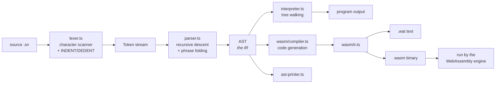

# Stickynight

A small programming language with English-phrase syntax, and the complete
compiler pipeline for it: a hand-written lexer, a recursive-descent parser, a
tree-walking interpreter, and a WebAssembly code-generation back end. Written
from scratch in TypeScript, with no parser generator and no runtime
dependencies.

```stickynight
define classify with score:
    if score is at least 90:
        give back "A"
    otherwise if score is at least 75:
        give back "B"
    otherwise:
        give back "C"

set marks to 82
say classify(marks)
```

No braces, no semicolons, no `>=` or `&&`. Blocks are indentation, comparisons
are phrases, and every error is a sentence with a line number and a suggestion.

---

## Quick start

```bash
npm install
npm run build

node dist/src/cli.js examples/02-grades.sn     # run a program
node dist/src/cli.js                           # interactive prompt
npm test                                       # 308 tests
npm run playground                             # the browser playground
```

---

## The pipeline



Every stage can be looked at on its own:

```bash
node dist/src/cli.js --tokens   examples/02-grades.sn   # after the lexer
node dist/src/cli.js --ast      examples/02-grades.sn   # after the parser
node dist/src/cli.js --wat      examples/11-wasm-demo.sn # generated code
node dist/src/cli.js --compiled examples/11-wasm-demo.sn # compile, then run
```

The last two are the point of the code generator: `--compiled` builds a real
`.wasm` module, hands it to the WebAssembly engine built into Node, and runs
*that* — and it prints exactly what the interpreter prints. The test suite
checks this for nineteen programs.

---

## What is in here

```
SPEC.md                 the language specification and the design decisions
ROADMAP.md              the project report: plan, what was built, what it cost
docs/
  GRAMMAR.ebnf          the full grammar on its own
  ARCHITECTURE.md       how the code is laid out, and why
  VIVA.md               the questions worth being able to answer, and answers

src/
  token.ts              token types — the Day 1 contract between the tracks
  ast.ts                AST node types — the other half of that contract
  errors.ts             one error format shared by all four stages
  lexer.ts              hand-written scanner, indentation stack
  parser.ts             recursive descent, phrase folding, error recovery
  ast-printer.ts        tree and s-expression printers
  values.ts             the runtime value model
  environment.ts        the scope chain
  builtins.ts           the standard library
  interpreter.ts        the tree-walking evaluator
  wasm/
    ir.ts               low-level IR: one instruction list per function
    compiler.ts         AST  -> IR   (lowering, alpha renaming, branch depths)
    wat.ts              IR   -> .wat text
    binary.ts           IR   -> .wasm bytes, and a runner for them
  stickynight.ts        the facade every host uses
  cli.ts, repl.ts       the command line
  dev/mock-tokens.ts    the hand-written token stream the two tracks agreed on

examples/               eleven programs, one per feature
examples/errors/        fourteen deliberately broken ones
playground/             the browser playground
tests/                  308 tests across six files
```

---

## The command line

```
stickynight <file.sn>          run a program
stickynight                    interactive prompt

  --tokens <file>    the token stream the lexer produces
  --ast <file>       the syntax tree the parser builds
  --sexp <file>      the same tree, one line per statement
  --wat <file>       WebAssembly text format
  --wasm <file>      write a runnable .wasm binary
  --compiled <file>  compile to WebAssembly and run that
  --check <file>     report every syntax error without running anything
  --steps <n>        stop after n statements (guards an endless loop)
  --no-color
```

The prompt keeps its state between lines, and understands `.help`,
`.builtins`, `.vars`, `.tokens <code>`, `.ast <code>`, `.clear` and `.quit`.
A line ending in `:` opens a block; a blank line closes it and runs it.

---

## The playground

```bash
npm run playground     # http://localhost:5173
```

An editor with syntax highlighting and four tabs — **Output**, **Tokens**,
**Tree**, **WebAssembly** — so the same program can be followed through every
stage without leaving the page. The dropdown loads all eleven examples plus
all fourteen broken ones, so the error messages can be demonstrated live.

The whole compiler runs in the browser: `scripts/bundle.mjs` walks the module
graph from `src/stickynight.ts` and packs what it finds into one file. Nothing
is reimplemented for the web.

---

## Errors

Every stage reports in the same shape, with the line, a caret under the
problem, and a suggestion.

```
$ node dist/src/cli.js examples/errors/symbol-comparison.sn

Lexical error in examples/errors/symbol-comparison.sn, line 3:

   2 | set age to 20
   3 | if age >= 18:
     |        ^^

  '>=' is not part of Stickynight.
  hint: Write 'is at least', as in: if score is at least 90:
```

```
$ node dist/src/cli.js examples/errors/wrong-args.sn

Runtime error in examples/errors/wrong-args.sn, line 5:

   4 |
   5 | say greet("Ada")
     |                ^

  'greet' needs 2 inputs, but it was given 1.
  hint: Its inputs are: first, last
```

`--check` reports every syntax error in a file in one pass rather than
stopping at the first, using panic-mode recovery.

---

## Tests

```bash
npm test
```

| File | What it pins down |
| --- | --- |
| `lexer.test.ts` | tokens, indentation, blank lines inside blocks, every rejection message |
| `parser.test.ts` | precedence, phrase folding, block forms, panic-mode recovery |
| `integration.test.ts` | the real lexer still matches the hand-written token stream from Day 1 |
| `interpreter.test.ts` | semantics: scope, closures, loops, lists, built-ins, runtime errors |
| `errors.test.ts` | all four stages report in the same shape, with the caret in the right column |
| `wasm.test.ts` | the binary validates, and compiled output matches the interpreter |
| `examples.test.ts` | every example runs and prints what it should; every broken one fails at the right stage |

---

## How the parallel build worked

The lexer → parser → interpreter chain is sequential, so splitting the work by
day would have left one person idle. It was split by **pipeline half**
instead, after a joint first day that fixed the two type contracts —
`src/token.ts` and `src/ast.ts` — that both halves build against.

The back end then developed the whole parser against
`src/dev/mock-tokens.ts`, a token stream typed out by hand, while the front
end was still writing the scanner. When both were ready the mock was swapped
for the real lexer.

`tests/integration.test.ts` keeps that swap honest: it asserts the real lexer
still produces exactly the stream that was agreed on Day 1....

---

## Where each course topic shows up

| Topic | Where |
| --- | --- |
| Lexical analysis | `src/lexer.ts` — hand-written scanner, `INDENT`/`DEDENT` synthesis |
| Regular expressions / finite automata | the same file: number, text and identifier rules written out as the transitions a DFA would have, with no regex used |
| Context-free grammar | `docs/GRAMMAR.ebnf`, written before the parser and used to derive it |
| Syntax analysis | `src/parser.ts` — recursive descent, multi-word phrase folding |
| Error handling and recovery | `src/errors.ts`, plus panic-mode recovery in `parseWithRecovery` |
| Semantic analysis | `src/environment.ts` — scope chain, undefined names, arity and type checks |
| Intermediate representation | `src/ast.ts` consumed by three back ends; `src/wasm/ir.ts` for the low-level one |
| Code generation | `src/wasm/` — lowering, alpha renaming, branch-depth resolution, LEB128 binary encoding |
| Execution | `src/interpreter.ts`, and the compiled module run by the WebAssembly engine |

---

## Licence

MIT.
